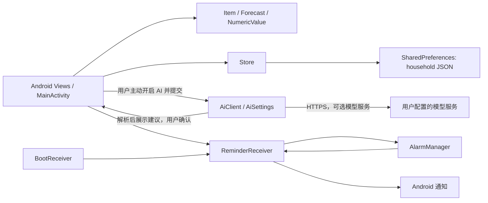

# Replenest · 家有余量

Android 离线家庭消耗品补货助手。先回答“什么时候需要再买”，再提供购买渠道搜索入口。

## 体验

- 测试安装包：[下载 Replenest-0.1.5-debug.apk](https://github.com/wang-ironman/Replenest/raw/refs/heads/main/artifacts/Replenest-0.1.5-debug.apk)（[仓库内文件](artifacts/Replenest-0.1.5-debug.apk)），Android 8.0 及以上；可直接覆盖安装旧版。
- 首次启动没有模拟库存。点“登记常用品”，选模板后修改实际数量和使用周期。
- 数量单位直接选择，模板自动带出；自定义用品默认“份”。商品规格收在选填项中，不填规格也能根据数量和使用周期预测。
- 数字可点加减按钮、选择常用值或滑动选择，也能用数字键盘输入。支持 0.5 瓶等小数，提前提醒天数只接受整数；混入字母、汉字或重复小数点会被拦截，空值、越界和不允许的零值不能保存。
- 需要记录规格时，展开选填项。例如每瓶 2000 毫升、现有 2 瓶，自动合计 4000 毫升。
- “设置 → 体验示例数据”可主动添加带“示例”标记的记录。
- 首页查看预计余量；采购清单区分“已下单”和“确认到货”；实际到货后才补充库存。
- 本地通知默认关闭；“设置 → 开启本地提醒”申请通知权限。
- 用“导出备份”保管数据，恢复前会显示记录数量并确认替换。

## 可选大模型

默认不开启，不配置 API 也能完成全部补货规则流程。

1. 设置 → 配置 API 与模型，选择平台预设或填写兼容 API 基础地址。
2. 填写自己的 API Key；点击“获取模型列表并选择”，可搜索实际返回的模型。
3. 选支持文本对话的模型，或者直接填写模型 ID，点击“开启 AI”保存并立即开启。
4. 登记常用品 → 用 AI 描述常用品，输入规格、当前余量和使用习惯。
5. 核对 AI 建议，确认并保存后才生成用品。

设置页与 API 配置页都有明确的“开启 AI / 关闭 AI”按钮，状态立即生效。关闭只停用 AI，保留 API、模型和密钥。底部“保存配置”只保存设置，不会自动开启；保存后会提示当前开关状态。

支持 OpenAI 兼容 `chat/completions` 与模型发现接口，不代表所有平台的所有模型都已实测。百炼可填写独立模型列表地址。接口没有模型列表或暂时不可用时，仍可手填模型 ID。

只在用户主动获取模型或生成建议时请求配置的服务。AI 不自动读取全屋记录，不自动下单；调用可能产生服务商费用。密钥使用 Android Keystore 加密，不包含在 JSON 备份中。仅支持 HTTPS；不要在源码中填写真实密钥。

## 本地构建

项目原生 Java / Android Views，无第三方运行时库，不依赖远程网页。当前构建脚本可复用本机已有 Android 工具和 Gradle 下载缓存，不复制其他项目业务代码。

```powershell
.\scripts\test-core.ps1
.\scripts\build-android.ps1 -TestApk
.\scripts\test-android.ps1
```

需要 JDK 21、Gradle 8.13、Android SDK 36。可设置 `JAVA_HOME` / `ANDROID_HOME`，并用 `-ToolRoot` 指定包含 Gradle 的工具目录。构建产物和临时配置保存在本项目目录，Gradle 缓存可以复用指定工具目录。

核心源代码在 `android/app/src/main/java/com/replenest/app/`。产品规则和后续讨论见 [产品设计](docs/product-design.md)，验收与真实设备限制见 [验证记录](docs/verification.md)。

当前为本地测试签名安装包，尚未配置正式发行签名、应用商店发布或商业订阅。

## 技术栈

| 部分 | 当前实现 |
| --- | --- |
| 语言与编译 | Java 17 源码；Android Gradle Plugin 8.13.2；使用 JDK 21、Gradle 8.13 构建 |
| Android 平台 | `compileSdk` / `targetSdk` 36，`minSdk` 26（Android 8.0） |
| 界面 | Android 原生 `Activity` 与 Views；没有 Compose、Web 页面或第三方运行时库 |
| 本地数据 | Android `SharedPreferences` 内保存应用 JSON；通过系统文件选择器导入、导出 JSON 备份 |
| 预测与日期 | 纯 Java 规则计算，使用 `java.time.LocalDate` 按本地日期估算余量 |
| 网络（可选 AI） | `HttpURLConnection` 接口与 JSON，通过 HTTPS 连接服务；只接受 HTTPS 地址，不配置或不开启 AI 时，核心补货流程不发网络请求 |
| 定时提醒 | `AlarmManager.setAndAllowWhileIdle`、广播接收器与 Android 通知；无需精确闹钟权限 |

## 程序结构

应用按职责分成界面流程、本地领域计算、存储和系统服务几部分。`MainActivity` 同时负责 Android 界面、用户操作编排以及调用这些模块；项目没有另外一套服务器或独立的 UI 状态框架。

| 模块 | 职责 |
| --- | --- |
| `MainActivity` | 使用 Android Views 显示首页、用品编辑、采购清单和设置，处理登记、补货、到货、备份恢复以及用户主动发起的 AI 操作 |
| `Item`、`Forecast` | `Item` 保存一项用品的名称、数量、单位、日耗和日期等数据；`Forecast` 计算剩余数量、预计用完日期、补货时间及余量修正后的日耗 |
| `NumberInput`、`NumericValue` | 提供小数和整数的交互输入及校验，阻止非法数量进入预测计算 |
| `Store` | 读取和写入本地用品、历史记录与提醒开关；将其序列化为 JSON 字符串，保存在 `household` SharedPreferences 的 `data` 键中 |
| `AiSettings`、`AiClient` | 单独保存用户自愿配置的模型、地址、启用状态和密钥；按用户主动操作列出模型或发送单次用品建议请求 |
| `ReminderReceiver`、`BootReceiver` | 排定本地提醒、发送汇总通知，并在设备重启、时区或时间改变、应用更新后重新排定 |

主要调用关系：



### 一次用品登记或预测

用品表单先校验数值；`MainActivity` 将数据写入 `Item`，并经 `Store` 存入本地 JSON。显示预计余量与补货日期时，`Item` 调用 `Forecast`，根据登记时的库存基数、日耗和当前日期重新计算。系统没有逐日云端任务，也无需用户每天打卡。

### 可选 AI 请求

AI 默认关闭。用户明确开启并主动请求时，`AiClient` 才使用配置的 HTTPS 端点读取可用模型或提交本次输入；它不附带整份库存。服务返回的建议经过结构及数值校验，回到可编辑表单由用户确认后才写入 `Store`。模型服务不可用时仍可手动登记和使用规则预测。

### 本地提醒

开启提醒后，`ReminderReceiver` 用 `AlarmManager` 排定下一次本地时间 09:00 的非精确闹钟。广播触发时读取 `Store`，筛选已经到补货日期且没有暂停、延后或标记已下单的用品，发送汇总通知，然后排定下一天。`BootReceiver` 接收系统重启、时区变化、时间校准和应用升级广播，重新恢复提醒计划。Android 的省电策略可能延迟非精确闹钟。

## 数据与安全边界

- 日常用品数据只保存在应用私有的 `SharedPreferences`；`android:allowBackup="false"` 关闭 Android 系统自动备份。
- 用户通过系统文件选择器手动导入或导出 JSON。恢复时先解析、验证并显示记录数，再由用户确认替换本地用品；导出的文件不包含 AI 密钥或 AI 设置。
- AI 配置保存在独立的私有 `SharedPreferences`；API 密钥用 Android Keystore 中的密钥执行 AES/GCM 加密。
- Manifest 禁止明文网络流量；配置地址还需满足 HTTPS 校验。只有用户主动操作才会请求用户所配置的模型服务，调用可能产生服务商费用。
- 商品渠道仅供用户搜索；应用不读取实时价格或商家库存，也不执行下单、付款或云端同步。

## 自动化测试

- `scripts/test-core.ps1` 直接编译并运行纯 Java 预测和数值输入测试。
- `scripts/build-android.ps1 -TestApk` 构建调试 APK 和 Android 仪器测试 APK。
- `scripts/test-android.ps1 -Serial <模拟器序列号>` 在指定模拟器上运行 `acceptance`、`api`、`toggle` 和 `numeric` 仪器测试；该脚本会清除指定模拟器内本应用的测试数据。

纯 Java 测试覆盖预测和输入边界；仪器测试覆盖 Android 页面流程、AI API 契约和开关、数值输入等行为。现有模拟器验收记录和未覆盖的实机边界见 [验证记录](docs/verification.md)；历史记录不等于对所有 Android 设备或真实模型服务的验证。

## Android 模块文件

```text
android/app/src/main/java/com/replenest/app/
├── MainActivity.java       # 界面与用户流程
├── Item.java               # 用品数据模型
├── Forecast.java           # 纯 Java 消耗与补货计算
├── NumericValue.java       # 数字解析和范围校验
├── NumberInput.java        # Android 数字输入组件
├── Store.java              # 本地 JSON 持久化与备份校验
├── AiSettings.java         # 可选 AI 配置与密钥加密
├── AiClient.java           # 用户主动发起的 HTTPS 模型请求
├── ReminderReceiver.java   # 本地定时提醒和通知
└── BootReceiver.java       # 启动、时间及更新后重排提醒
```
